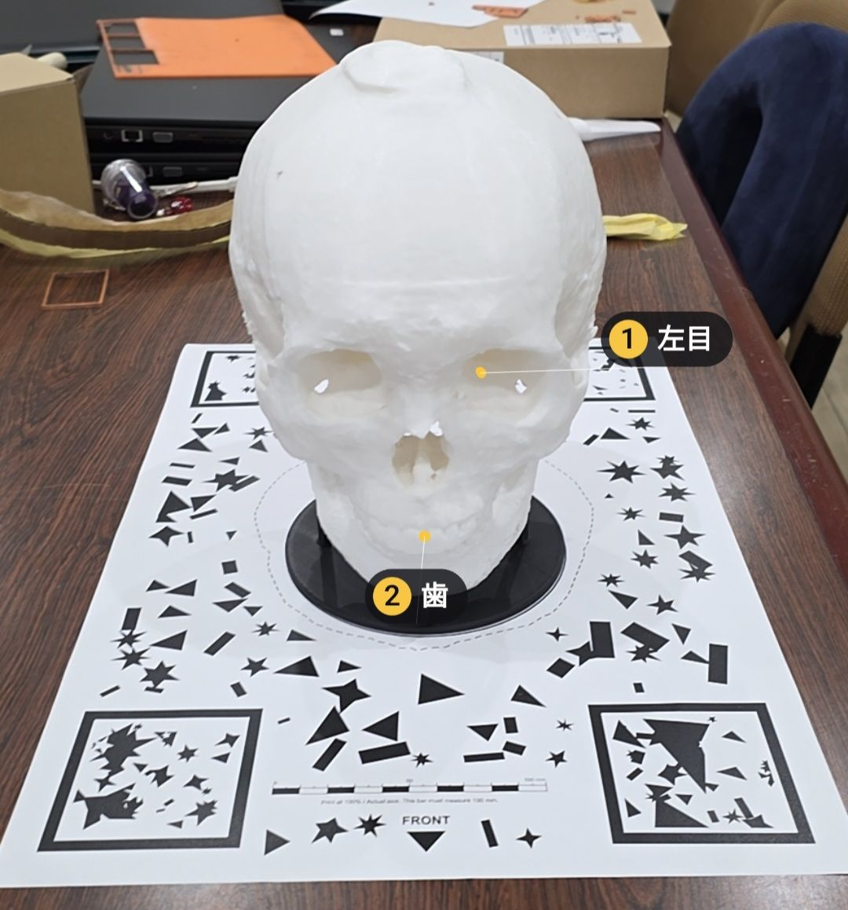
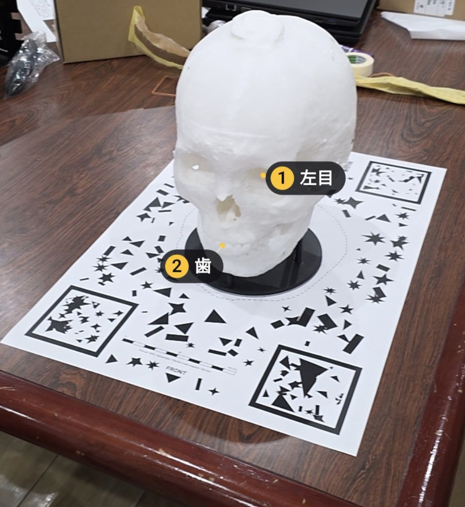
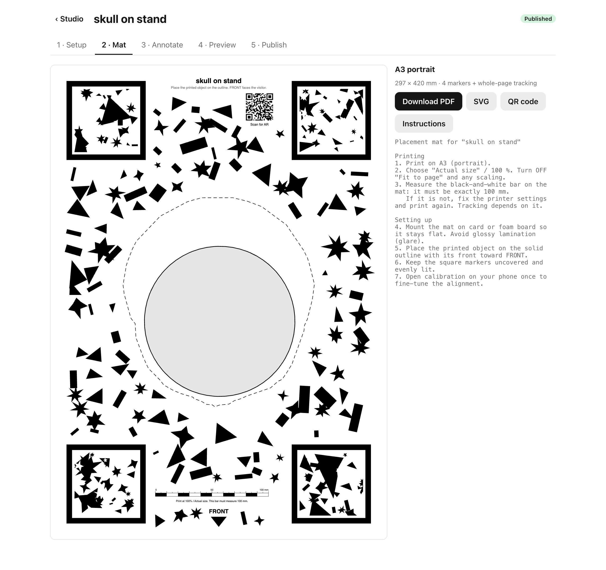
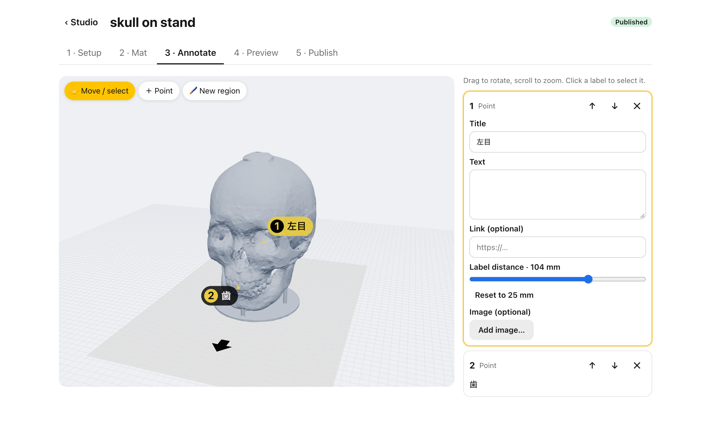
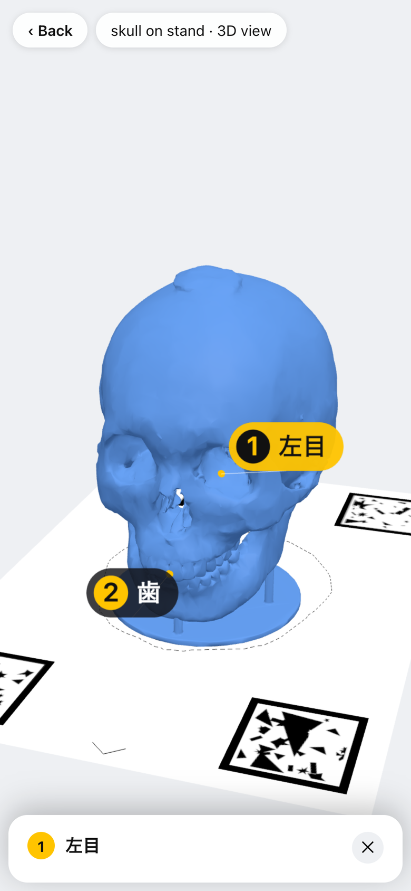

# ExhibitAR

**Turn any 3D-printed object into an AR exhibit: print a paper mat, scan a QR code, see labels
on the real object.**

[](https://exhibitar.vercel.app)
[](LICENSE)
[](package.json)
[](https://nextjs.org)
[](https://nodejs.org)

[Live app](https://exhibitar.vercel.app) · [Demo exhibit](https://exhibitar.vercel.app/v/mockcube01)
· [Spec](docs/SPEC.md) · [Architecture](docs/ARCHITECTURE.md) · [Contributing](CONTRIBUTING.md) ·
[Security](SECURITY.md)

<p>
  <a href="docs/images/ar-skull-front.jpg"></a>
  <a href="docs/images/ar-skull-angle.jpg"></a>
</p>

_In AR: a 3D-printed skull on its printed mat, seen through a phone. The labels (1 左目 "left
eye", 2 歯 "teeth") stay on the real object as the phone moves._

<p>
  <a href="docs/images/studio-mat.png"></a>
  <a href="docs/images/studio-annotate.png"></a>
  <a href="docs/images/viewer-phone.png"></a>
</p>

_The same skull exhibit, left to right: its printable placement mat, its annotations in the
Studio, and the visitor's view on a phone without AR (3D view with a label's details)._

## Features

An exhibitor uploads an STL, marks points of interest and prints a paper placement mat with
tracking markers. Visitors scan the QR code on the mat and see labels registered onto the real
object, with no app to build and no object recognition to train.

- **Works with any printed object.** Tracking uses only the printed mat (four image markers
  plus whole-page tracking). The object's pose is known because it stands on its printed
  outline.
- **Your STL never leaves your browser.** Parsing, simplification and mat generation run in
  Web Workers. Only the simplified model, the mat and the annotations are uploaded.
- **Printable mat in one click.** PDF/SVG with the object's outline, a FRONT arrow, a 100 mm
  check bar and the QR code, on A4/A3 or Letter/Tabloid. Larger objects tile across sheets.
- **Points and painted regions.** Each one has a title, text, an optional link and image, and
  a place in the guided tour.
- **Labels behave like the real thing.** In AR the printed object hides labels behind it, and
  labels fade when seen from behind.
- **Runs in the browser.** Android Chrome via WebXR image tracking; iPhone via the Needle Go
  App Clip (not yet device-tested). Other browsers get a 3D view of the exhibit.
- **One-time calibration** on a phone (`/studio/<id>/calibrate`), saved for every visitor.
- **Try it without an account.** The Studio works as an in-tab draft. Publishing needs
  sign-in (email + password or a passkey).

## Installation

Requires Node 24+ and pnpm 10 (`corepack enable` picks the pinned version).

```bash
git clone https://github.com/Jin-hiroo/exhibitar.git && cd exhibitar && pnpm install
```

Sign-in and publishing need a Supabase project: copy `.env.example` to `.env.local` and fill it
in (see [Self-hosting](#self-hosting)). Without it, everything else below still works.

## Usage

```bash
pnpm dev   # http://localhost:3000
```

1. Open http://localhost:3000/studio/new, pick a sample (or drop an STL) and click **Generate
   model & mat**.
2. **Mat**: download the PDF, print it at 100 % and place the printed object on the outline.
3. **Annotate**: click **＋ Point** and click the model, or paint a region; give it a title and
   text.
4. **Preview** shows the visitor's 3D view; **Publish** (signed in) gives the exhibit its
   `/v/<id>` page, which the QR code on the mat points to.

The demo exhibit needs no backend: open http://localhost:3000/v/mockcube01 and print
`/fixtures/mock-cube-mat.pdf` to try it in AR. Add `?debug` to any `/v/<id>` URL for the
tracking HUD. For the full product and data model, see [docs/SPEC.md](docs/SPEC.md) and
[docs/ARCHITECTURE.md](docs/ARCHITECTURE.md).

## Development

Contributor rules: [CONTRIBUTING.md](CONTRIBUTING.md) and [CLAUDE.md](CLAUDE.md).
Workstreams: [docs/TASKS.md](docs/TASKS.md).

| Command                       | What it does                                                                                                            |
| ----------------------------- | ----------------------------------------------------------------------------------------------------------------------- |
| `pnpm dev`                    | local dev server on http://localhost:3000                                                                               |
| `pnpm lint && pnpm typecheck` | ESLint + `next typegen` + `tsc --noEmit`                                                                                |
| `pnpm test`                   | Vitest unit tests (`src/**/*.test.ts`, `tests/**/*.test.ts`)                                                            |
| `pnpm test:e2e`               | Playwright smoke tests (starts its own dev server on :3100)                                                             |
| `pnpm fixtures`               | writes fixture STLs (binary + ASCII) to `tests/fixtures/out/`                                                           |
| `pnpm demo`                   | runs the full geometry + mat pipeline on every fixture → `tests/fixtures/out/demo/` (GLB, mat SVG/PDF, marker PNGs, QR) |
| `pnpm mock`                   | regenerates `tests/fixtures/project.mock.json` + `public/fixtures/*` from the real pipeline                             |

## Try the AR viewer (Android)

1. Phone: Chrome + "Google Play Services for AR"; enable `chrome://flags/#webxr-incubations`.
2. Print `http://localhost:3000/fixtures/mock-cube-mat.pdf` at **Actual size** (A4 landscape).
3. `pnpm dev`, connect the phone by USB, `adb reverse tcp:3000 tcp:3000`.
4. On the phone open `http://localhost:3000/v/mockcube01?debug` → **Start AR** → point at the mat.

Full checklist: [docs/DEVICE-TESTS.md](docs/DEVICE-TESTS.md). Findings: [docs/D0-FINDINGS.md](docs/D0-FINDINGS.md).

## Testing WebXR on a phone (HTTPS)

WebXR only runs in a secure context. Three options, easiest first:

1. **Android over USB (recommended for Android).** Plain `pnpm dev`, then
   forward the port so the phone sees it as `localhost` (a secure context):

   ```bash
   adb reverse tcp:3000 tcp:3000
   ```

   Open `http://localhost:3000` in Chrome on the phone. Remote-debug via
   `chrome://inspect` on the desktop.

2. **Over Wi-Fi with a local certificate.**

   ```bash
   pnpm dev --experimental-https --hostname 0.0.0.0
   ```

   Next.js generates a certificate with mkcert. The phone must trust the mkcert
   root CA (`mkcert -CAROOT` → install `rootCA.pem` on the device), otherwise
   WebXR will refuse the page. Browse to `https://<your-LAN-IP>:3000`.

3. **Vercel preview deployment.** Every pushed branch gets an HTTPS preview URL.
   Previews are behind Vercel Authentication, so sign in on the phone first
   (or use the production domain for public audience tests).

## Self-hosting

ExhibitAR is a Next.js app backed by a Supabase project (auth, Postgres, storage). Without
Supabase env vars the Studio still works as an in-tab draft and the demo exhibit still loads;
only sign-in and publishing are disabled.

1. **Create a Supabase project** and apply the SQL in `supabase/migrations/` in file order,
   either with the Supabase CLI (`supabase link --project-ref <ref>` then `supabase db push`)
   or by pasting each file into the SQL editor. This creates the `projects` table, row-level
   security, the viewer functions and the storage buckets.
2. **Auth settings** in the Supabase dashboard. The app sends no email.
   - **Sign In / Providers → Email**: enabled, with **Confirm email** off. Otherwise sign-up
     sends a confirmation email, and the built-in mailer allows only a few per hour. There is
     no "forgot password": sign in with a passkey and change the password at
     `/studio/account`, or reset the user from the dashboard.
   - **Passkeys**: enabled, with your production domain as the RP ID and
     `https://<your-domain>` as the origin. Passkeys then work only on that domain, not on
     previews or localhost; password sign-in works everywhere. Don't change the RP ID once
     people have passkeys: that invalidates all of them.
   - See [SECURITY.md](SECURITY.md) for hardening settings.
3. **Environment variables** (see `.env.example`): `NEXT_PUBLIC_SUPABASE_URL`,
   `NEXT_PUBLIC_SUPABASE_PUBLISHABLE_KEY` and `NEXT_PUBLIC_SITE_URL`. The site URL is what
   printed QR codes point at, so it must be your production domain.
4. **Deploy.** On Vercel, import the repository and set the variables for all environments;
   `main` deploys to production and branches get previews. Any host that runs Next.js works.

## License

ExhibitAR is licensed under the [Apache License 2.0](LICENSE). See [NOTICE](NOTICE).
